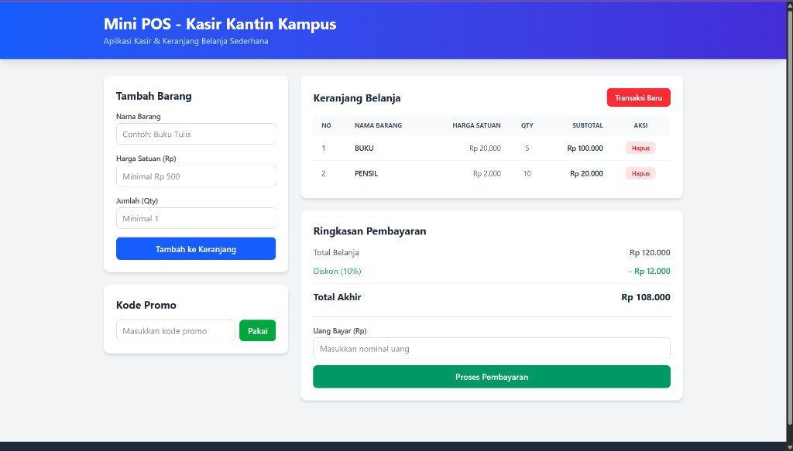

# Mini POS - Kasir Kantin Kampus

Nama : Exaudi Amin Hutasoit  
NIM  : 123140161  

---

## Deskripsi Singkat

Mini POS v2.0 adalah aplikasi kasir dan pengelolaan inventaris kantin kampus yang dibangun menggunakan **HTML**, **Tailwind CSS**, dan **JavaScript (ES6+)**. 

Aplikasi ini menerapkan konsep **Object-Oriented Programming (OOP)**, operasi asinkron (**`async/await`**) untuk mengambil data menu dari REST API publik, serta penyimpanan data lokal menggunakan **`localStorage`**.

---

## Cara Menjalankan

1. **Clone Repositori dari GitHub**
   ```bash
   git clone <URL_REPOSITORI_GITHUB>
   ```
2. **Masuk ke Folder Tugas**
   ```bash
   cd "Exaudi Amin Hutasoit_123140161_pertemuan2"
   ```
   *(atau sesuaikan dengan path folder tugas di dalam repositori Anda)*

3. **Buka Aplikasi**
   - Buka file `index.html` langsung di browser (Chrome, Edge, Firefox), atau
   - Buka folder di **VS Code**, klik kanan pada file `index.html` → pilih **Open with Live Server**.

---

## Fitur Utama

- **Form Input Tambah Barang**: Input nama barang, harga satuan, dan kuantitas dengan validasi input (error merah jika tidak valid).
- **Tabel Keranjang Belanja**: Menampilkan daftar barang, kuantitas, harga, subtotal otomatis, serta tombol hapus per baris dan tombol reset transaksi.
- **Kalkulator Diskon & Promo**: Diskon otomatis 10% jika belanja mencapai minimal Rp 50.000 atau menggunakan kode promo `HEMAT10`.
- **Kalkulator Pembayaran & Kembalian**: Menghitung uang kembalian secara otomatis saat proses pembayaran.
- **Impor Menu dari API (Asynchronous)**: Mengambil data menu dari REST API publik (DummyJSON) menggunakan `async/await`.
- **Penyimpanan Persisten (LocalStorage)**: Seluruh data keranjang dan status promo tersimpan di browser dan tidak hilang saat di-refresh.

---

## Penerapan ES6+ & OOP

- **Classes (OOP)**: Menggunakan class `CartItem` (enkapsulasi data barang & subtotal) dan class `POSApp` (controller utama).
- **Async / Await**: Mengambil data menu dari REST API publik menggunakan `fetch()` dengan penanganan error `try...catch`.
- **Arrow Functions (`=>`)**: Digunakan pada event listener dan method array (`map`, `filter`, `reduce`, `findIndex`).
- **Destructuring**: Mengekstrak properti objek secara ringkas (contoh: `const { nama, harga, qty } = item;`).
- **Spread Operator (`...`)**: Memperbarui data keranjang secara immutable (`[...this.keranjang, newItem]`).
- **Template Literals (`` `${...}` ``)**: Menghasilkan baris tabel HTML keranjang belanja secara dinamis.
- **`let` dan `const`**: Seluruh variabel dideklarasikan tanpa menggunakan `var`.

---

## Tangkapan Layar Aplikasi



> **Tampilan Utama:**  
> Sisi kiri menampilkan form input "Tambah Barang" dan kolom "Kode Promo". Sisi kanan menampilkan tabel "Keranjang Belanja" lengkap dengan subtotal dan tombol aksi, serta panel "Ringkasan Pembayaran" dan kalkulator kembalian. Pada bagian header terdapat tombol "Impor Menu API" untuk mengambil data eksternal.

---

## Struktur Berkas

```
Exaudi Amin Hutasoit_123140161_pertemuan2/
├── index.html       # Antarmuka kasir dan keranjang belanja
├── style.css        # Styling tampilan dan animasi
├── script.js        # Logika ES6+, OOP Class, Async Fetch API & LocalStorage
├── Gambar1.png      # Screenshot antarmuka aplikasi
├── README.md        # Dokumentasi aplikasi
└── modul/           # Berkas latihan modul praktikum
    ├── index.html
    └── script.js
```
