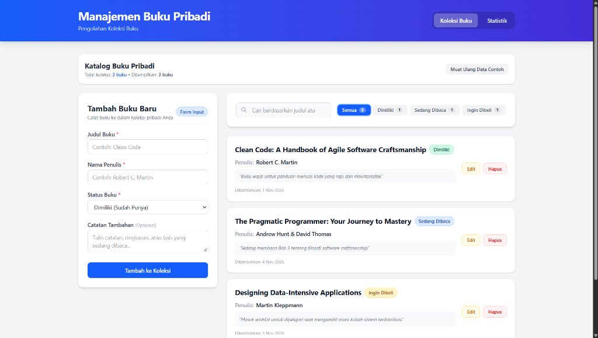
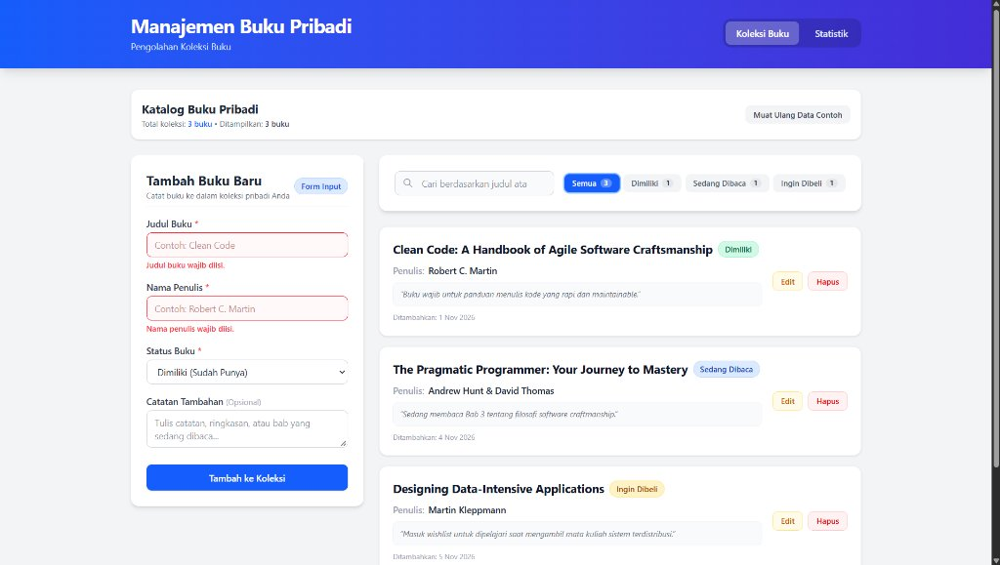
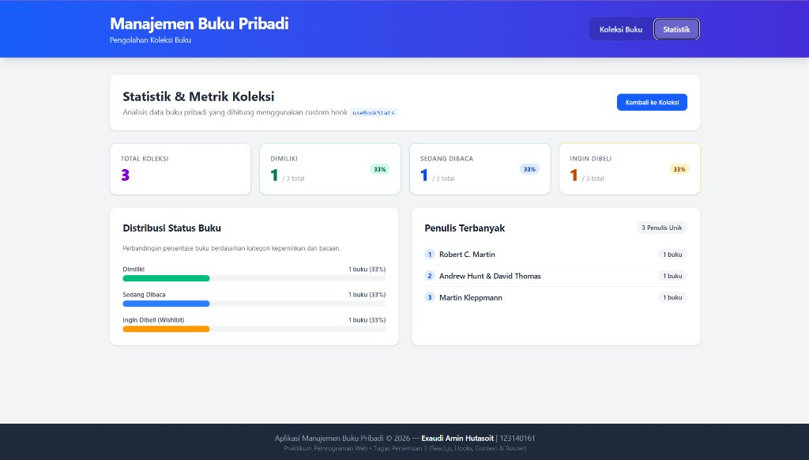
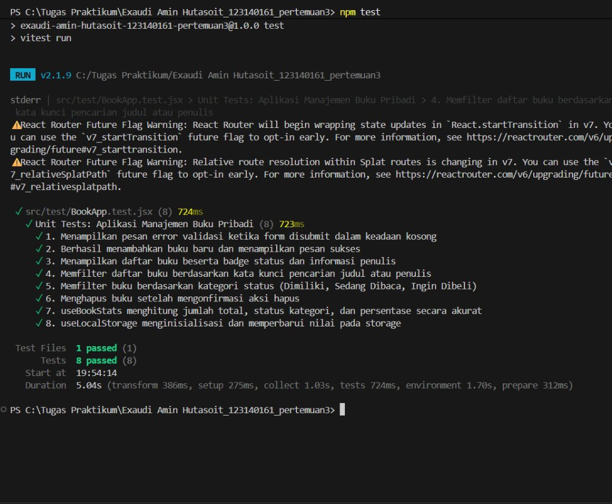

# Aplikasi Manajemen Buku Pribadi


 Nama Lengkap    : Exaudi Amin Hutasoit                             
 NIM             : 123140161                                        
 Kelas Praktikum : Pemrograman Web RB                               
 Pertemuan       : Pertemuan 3 (React.js, Hooks, Context & Router)  

---

## Deskripsi Singkat

**Aplikasi Manajemen Buku Pribadi** adalah aplikasi berbasis web yang dibangun menggunakan **React.js (Vite)** dan **Tailwind CSS**. Aplikasi ini memungkinkan pengguna untuk mengelola katalog buku pribadi secara terstruktur, mencakup pencatatan buku yang sudah dimiliki, sedang dibaca, maupun yang ingin dibeli (wishlist).

Aplikasi ini dirancang dengan antarmuka yang bersih, modern, dan konsisten dengan tugas-tugas praktikum sebelumnya (gradien biru-indigo, kartu putih dengan bayangan lembut, badge status elegan, serta tata letak responsif). Seluruh data tersimpan secara persisten pada peramban web menggunakan **`localStorage`**.

---

## Fitur Utama Aplikasi

1. **Tambah Buku Baru**: Form input judul buku, nama penulis, status buku, dan catatan opsional dengan validasi ketat serta visual feedback error.
2. **Edit & Perbarui Buku**: Mode edit langsung yang mengisi kembali form secara otomatis dan memperbarui data buku tanpa menghilangkan riwayat tanggal pembuatan.
3. **Hapus Buku Aman**: Penghapusan data buku dilengkapi dengan tombol konfirmasi (*inline confirmation*) untuk mencegah penghapusan yang tidak disengaja.
4. **Pencarian Real-Time**: Mencari buku berdasarkan judul atau nama penulis secara instan dengan tombol pembersih pencarian cepat (*clear button*).
5. **Filter Status Interaktif**: Memfilter daftar buku berdasarkan kategori (`Semua`, `Dimiliki`, `Sedang Dibaca`, `Ingin Dibeli`) yang dilengkapi indikator jumlah buku per status.
6. **Statistik & Metrik Koleksi**: Halaman analitik khusus yang menampilkan ringkasan kartu metrik, bar kemajuan visual persentase kepemilikan, dan daftar penulis terbanyak.
7. **Penyimpanan Persisten (LocalStorage)**: Seluruh buku tersimpan otomatis di browser lokal pengguna sehingga data tidak hilang saat halaman di-refresh.
8. **Navigasi Multi-Halaman**: Perpindahan halaman mulus tanpa reload menggunakan **React Router DOM v6** antara halaman Koleksi Buku dan halaman Statistik.

### Langkah Menjalankan

1. **Buka Terminal / Command Prompt** dan pastikan berada di folder project ini:
   ```bash
   cd "c:\Tugas Praktikum\Exaudi Amin Hutasoit_123140161_pertemuan3"
   ```

2. **Pasang Dependensi (jika belum dipasang)**:
   ```bash
   npm install
   ```

3. **Jalankan Development Server**:
   ```bash
   npm run dev
   ```
   Aplikasi akan berjalan secara lokal di alamat: `http://localhost:5173` (buka tautan tersebut di peramban web seperti Google Chrome atau Microsoft Edge).

## Penerapan Konsep & Fitur React

Aplikasi ini memenuhi seluruh persyaratan teknis yang diwajibkan:

### 1. Functional Components & Hooks
- Menggunakan pendekatan komponen fungsional modern secara konsisten.
- **`useState`**: Digunakan untuk state lokal form, pesan error validasi, status edit aktif, dan konfirmasi hapus.
- **`useEffect`**: Digunakan untuk sinkronisasi data edit ke form dan sinkronisasi otomatis ke `localStorage`.
- **`useMemo`**: Digunakan untuk mengoptimalkan proses filter dan pencarian buku serta kalkulasi metrik analitik agar tidak terjadi perhitungan ulang yang tidak perlu.
- **`useContext`**: Digunakan melalui custom hook `useBooks()` untuk mengakses context global dengan aman.

### 2. Custom Hooks (Minimal 2 Hooks)
- **`useLocalStorage.js`**: Mengenkapsulasi logika pembacaan, penulisan, dan penanganan error `localStorage` browser sehingga state tetap sinkron dan persisten.
- **`useBookStats.js`**: Menghitung metrik analitik dari daftar buku, meliputi total buku, jumlah per status, persentase kepemilikan, jumlah penulis unik, serta daftar penulis terpopuler secara reaktif.

### 3. State Management dengan Context API
- **`BookContext.jsx`**: Menyediakan state global (`books`, `filteredBooks`, `searchTerm`, `selectedStatus`, `editingBook`) serta aksi (`addBook`, `updateBook`, `deleteBook`, `startEditing`, `cancelEditing`, `resetToSampleData`) ke seluruh komponen tanpa *prop drilling*.
- Dilengkapi dengan *custom consumer hook* **`useBooks()`** yang memvalidasi ketersediaan context sebelum digunakan.

### 4. Navigasi Multi-Halaman (React Router)
- Menggunakan **`react-router-dom` (v6)** dengan konfigurasi:
  - Route `/` : Menampilkan halaman utama koleksi buku (`Home.jsx`).
  - Route `/stats` : Menampilkan halaman analitik statistik buku (`Stats.jsx`).
  - Route `*` : *Catch-all redirect* otomatis kembali ke halaman utama.
  - Komponen **`Navbar`** menggunakan **`NavLink`** untuk memberikan visual penanda rute yang sedang aktif.

### 5. Komponen Reusable
- **`BookForm`**: Komponen form serbaguna yang dapat beralih secara dinamis antara mode Tambah dan mode Edit.
- **`BookList`**: Komponen daftar buku dengan badge status, kartu detail buku, dan tombol aksi interaktif.
- **`BookFilter`**: Komponen pencarian dan filter kategori dengan tombol interaktif dan penghitung badge.
- **`Navbar`**: Komponen navigasi header dengan identitas mahasiswa dan menu halaman.
- **`Footer`**: Komponen kaki halaman dengan informasi hak cipta dan identitas praktikum.

### 6. Type Checking dengan PropTypes
- Seluruh komponen (`BookForm`, `BookList`, `BookFilter`, `Navbar`, `Footer`, `StatCard`, dan `BookProvider`) menerapkan validasi tipe data menggunakan library **`prop-types`** untuk memastikan integritas data props.

### 7. Error Handling & Validasi Form
- Validasi wajib isi pada kolom Judul Buku dan Nama Penulis (panjang minimal 2 karakter).
- Visual feedback error berupa border input berwarna merah, latar belakang lembut merah, teks peringatan kesalahan, serta atribut aksesibilitas `aria-invalid`.
- Notifikasi status sukses berwarna hijau setelah data berhasil disimpan atau diperbarui.

---

## Laporan Pengujian (Unit Testing)

Pengujian unit dilakukan menggunakan **Vitest** dan **@testing-library/react** dengan total **8 skenario pengujian** yang menguji seluruh fitur utama dan logika bisnis:

```text
✓ src/test/BookApp.test.jsx (8 tests)
  ✓ 1. Menampilkan pesan error validasi ketika form disubmit dalam keadaan kosong
  ✓ 2. Berhasil menambahkan buku baru dan menampilkan pesan sukses
  ✓ 3. Menampilkan daftar buku beserta badge status dan informasi penulis
  ✓ 4. Memfilter daftar buku berdasarkan kata kunci pencarian judul atau penulis
  ✓ 5. Memfilter buku berdasarkan kategori status (Dimiliki, Sedang Dibaca, Ingin Dibeli)
  ✓ 6. Menghapus buku setelah mengonfirmasi aksi hapus
  ✓ 7. useBookStats menghitung jumlah total, status kategori, dan persentase secara akurat
  ✓ 8. useLocalStorage menginisialisasi dan memperbarui nilai pada storage

Test Files  1 passed (1)
     Tests  8 passed (8)
```

---

## Tangkapan Layar Aplikasi

Berikut adalah panduan tangkapan layar antarmuka aplikasi untuk laporan praktikum:

### 1. Halaman Utama — Koleksi Buku & Form Input

> **Gambar 1:** Menampilkan tata letak 2 kolom bergaya tugas sebelumnya: sisi kiri adalah Form Tambah Buku dengan validasi input, dan sisi kanan adalah filter status, kolom pencarian, serta daftar kartu buku lengkap dengan badge status (`Dimiliki`, `Sedang Dibaca`, `Ingin Dibeli`).

### 2. Validasi Form & Fitur Edit Buku

> **Gambar 2:** Menampilkan feedback visual error saat form disubmit kosong (garis merah dan pesan error) serta mode edit saat salah satu buku dipilih untuk diperbarui.

### 3. Halaman Statistik & Analisis Koleksi

> **Gambar 3:** Menampilkan halaman `/stats` dengan 4 kartu metrik (Total Buku, Dimiliki, Sedang Dibaca, Ingin Dibeli), visual progress bar persentase kepemilikan, dan daftar penulis terbanyak.

### 4. Hasil Eksekusi Unit Test di Terminal

> **Gambar 4:** Hasil eksekusi `npm test` di terminal yang membuktikan seluruh 8 skenario test unit berhasil dijalankan (*100% Passed*).


