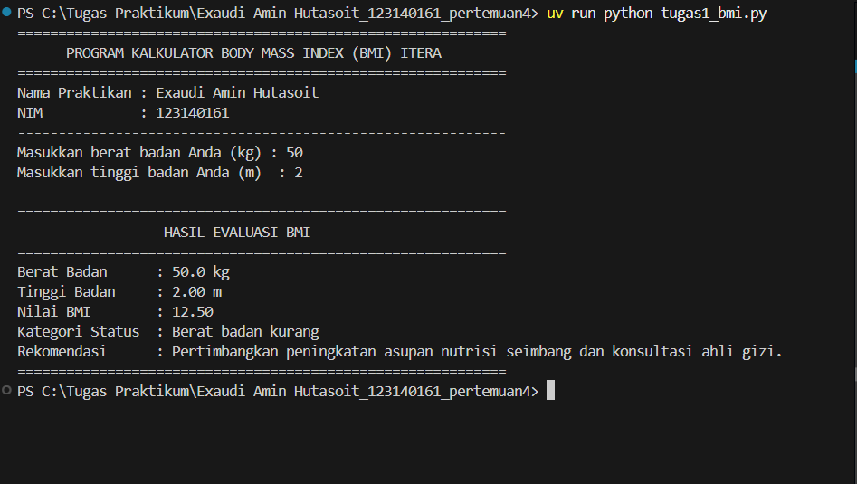
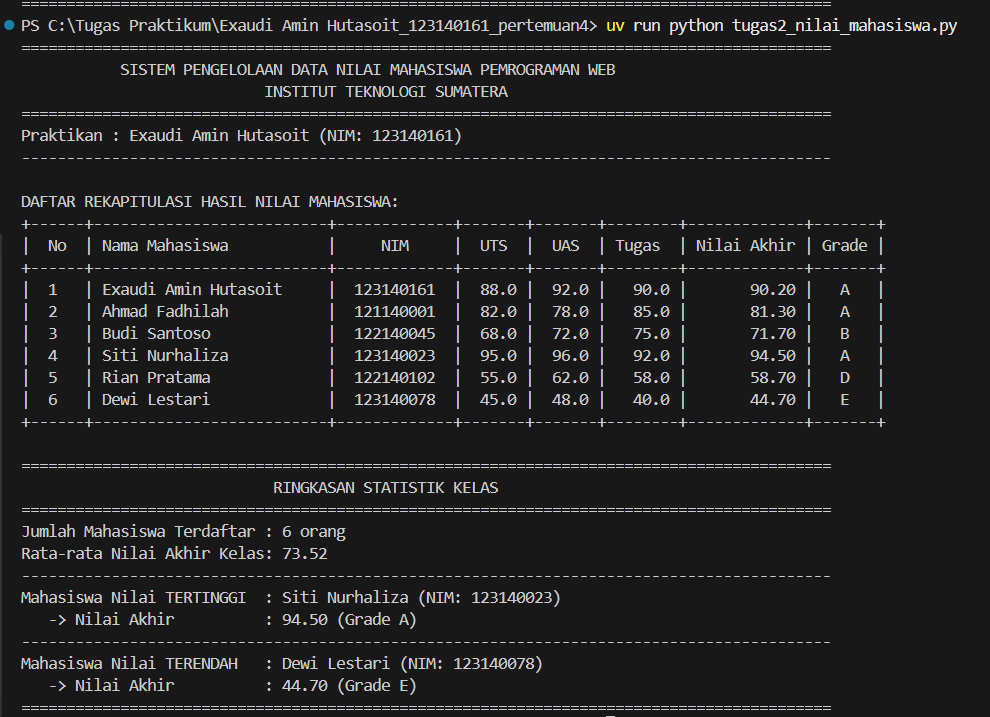
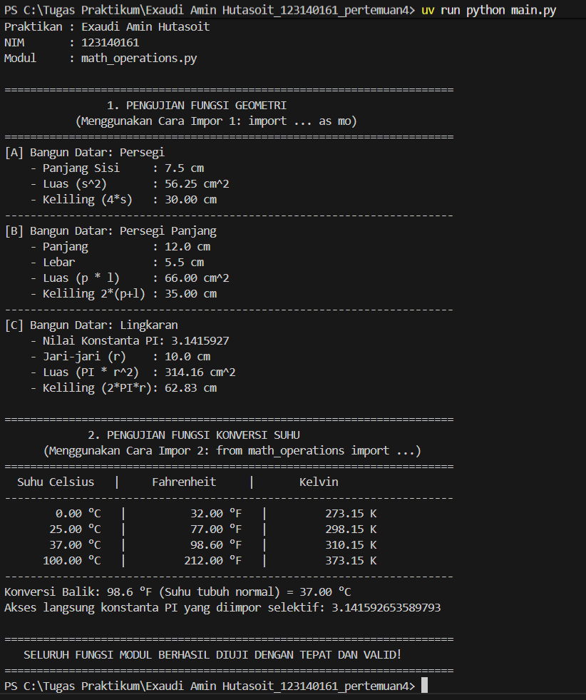

# Praktikum PAW - Pertemuan 4

**Nama:** Exaudi Amin Hutasoit  
**NIM:** 123140161  

---

## 1. Deskripsi
Praktikum ini menerapkan dasar pemrograman Python, meliputi variabel, operator, percabangan, perulangan, fungsi, struktur data, dan modul.

Terdapat tiga tugas yang dikerjakan:

* **Penghitung BMI (`tugas1_bmi.py`)**: Menghitung BMI berdasarkan berat dan tinggi badan (meter atau cm), kemudian menentukan kategori berat badan menggunakan percabangan `if-elif-else`.
* **Pengelolaan Nilai Mahasiswa (`tugas2_nilai_mahasiswa.py`)**: Mengolah data mahasiswa menggunakan list dan dictionary, menghitung nilai akhir (UTS 30%, UAS 40%, Tugas 30%), menentukan grade A–E, serta menampilkan nilai tertinggi dan terendah.
* **Modul Matematika (`math_operations.py` dan `main.py`)**: Menghitung luas dan keliling persegi, persegi panjang, lingkaran, serta konversi suhu Celsius ke Fahrenheit dan Kelvin. Program menggunakan dua cara import modul.

---

## 2. Teknologi
* Python 3.11+
* Visual Studio Code
* Git dan GitHub

---

## 3. Cara Menjalankan
Buka folder praktikum di VS Code, kemudian jalankan perintah berikut melalui terminal:

**Tugas 1 - BMI**
```bash
python tugas1_bmi.py
```
*(atau jika menggunakan uv: `uv run python tugas1_bmi.py`)*

**Tugas 2 - Nilai Mahasiswa**
```bash
python tugas2_nilai_mahasiswa.py
```
*(atau jika menggunakan uv: `uv run python tugas2_nilai_mahasiswa.py`)*

**Tugas 3 - Modul Matematika**
```bash
python main.py
```
*(atau jika menggunakan uv: `uv run python main.py`)*

---

## 4. Screenshot Hasil Pengujian

### Tugas 1 - Penghitung BMI


*Program berhasil menghitung nilai BMI berdasarkan berat badan (50 kg) dan tinggi badan (2 m), menghasilkan nilai BMI 12.50 yang tergolong dalam kategori "Berat badan kurang" beserta rekomendasi nutrisinya.*

---

### Tugas 2 - Nilai Mahasiswa


*Program berhasil mengolah data 6 mahasiswa ke dalam bentuk tabel yang rapi, menghitung nilai akhir berbobot (UTS 30%, UAS 40%, Tugas 30%), menentukan grade (A-E), serta mendeteksi nilai tertinggi (94.50 / Grade A) dan terendah (44.70 / Grade E).*

---

### Tugas 3 - Modul Matematika


*Modul `math_operations.py` berhasil diimpor dengan 2 cara berbeda (`import ... as mo` dan `from ... import ...`) untuk menghitung luas dan keliling geometri (persegi, persegi panjang, lingkaran) serta menampilkan tabel konversi suhu Celsius ke Fahrenheit dan Kelvin.*

---

## 5. Kesimpulan
Ketiga program berhasil menerapkan konsep dasar Python untuk perhitungan, pengolahan data, dan penggunaan modul dengan kode yang terstruktur serta mematuhi kaidah penulisan standar PEP 8.
